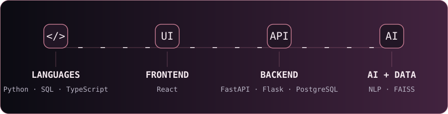
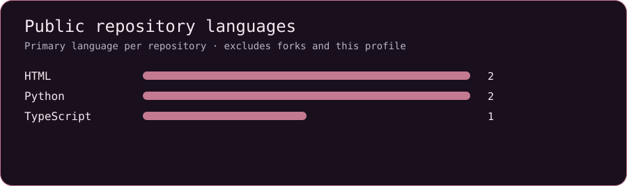

<p align="center">
  
</p>

<h1 align="center">Aahana Ahir</h1>

<p align="center">
  <strong>Final-year B.Tech student · Software, data, AI and product</strong>
</p>

I like figuring out where a workflow gets messy, then building something that makes it easier.

```yaml
interests: [software, data, applied AI, product engineering]
tools: [Python, SQL, TypeScript, React, FastAPI, Flask]
open_to: [internships, entry-level roles, project collaboration]
```

## Tools in use

<p align="center">
  
</p>

| Area | Where I’ve used it |
| --- | --- |
| **Python and NLP** | Data analysis and sentiment-analysis experiments. |
| **SQL** | Querying and working with structured data. |
| **TypeScript and React** | The interactive incident-investigation interface in [OpsAssist AI](https://github.com/aahanaahir22/opsassist-ai). |
| **FastAPI and PostgreSQL** | The API and persistence stack documented in [OpsAssist AI](https://github.com/aahanaahir22/opsassist-ai). |
| **Flask** | The backend for a mini app. |
| **FAISS** | The semantic retrieval index documented in [OpsAssist AI](https://github.com/aahanaahir22/opsassist-ai). |

## Selected projects

### OpsAssist AI

I built this prototype to explore how teams could use an AI assistant in their day-to-day operations.

**[Open the project ↗](https://opsassist-ai.aahanaahir12.chatgpt.site/)**

<details>
<summary><strong>B2B marketplace</strong> · Designing for two sides of a marketplace</summary>

I explored how sellers and manufacturers could list their businesses so buyers could discover them. I also reached out to potential sellers to see who would be interested in listing.

</details>

<details>
<summary><strong>Distress signal detection</strong> · An academic NLP prototype</summary>

I used sentiment analysis to explore how patterns in public social media posts might surface signs of distress. The project got me thinking about the limits of sentiment scores and when a flagged result needs human judgment.

</details>

## Current focus

- **Building** · Prototypes that make operational and data-heavy tasks easier to navigate.
- **Exploring** · How evidence-backed AI and product design can make complex workflows easier to follow.
- **Open to** · Internships, entry-level roles and project collaborations in software, data, AI and product.

## GitHub activity

[Contribution history](https://github.com/aahanaahir22#js-contribution-activity-description) · [Public repositories](https://github.com/aahanaahir22?tab=repositories) · [Achievements](https://github.com/aahanaahir22?tab=achievements)



<picture>
  <source media="(prefers-color-scheme: dark)" srcset="./midnight-snake-dark.svg" />
  
</picture>

## Connect

[<kbd>GitHub</kbd>](https://github.com/aahanaahir22) · [<kbd>Portfolio</kbd>](https://aahanaahir22.github.io/) · [<kbd>LinkedIn</kbd>](https://www.linkedin.com/in/aahanaahir02/)

I like building tools that make the next step easier to see.


